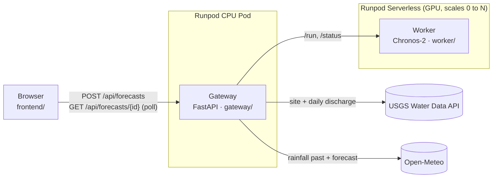

# River Outlook

**What will this river do next week?** Pick a USGS river gauge and River Outlook
returns a 7-day probabilistic flow forecast that accounts for the rain on its way.

It combines two free public APIs in one workflow:

1. **USGS Water Data API**: the gauge's location and its last 90 days of daily discharge.
2. **Open-Meteo**: daily rainfall at the gauge, the past 92 days plus the forecast.

Then it hands both series to **Chronos-2**, a time-series foundation model, running
on a **Runpod Serverless GPU** endpoint. Rainfall is passed as a *covariate*: past
rain alongside past flow, plus the rain forecast for the days being predicted. If
the GPU path fails, the gateway answers with a CPU statistical baseline instead.

> **Does the rain input help? Not proven yet.** On the Potomac (2026-10-09, 57 mm
> forecast over 7 days), adding rain made the day-7 forecast *lower and narrower*
> (median 1,597 cfs, 90th percentile 2,889) than flow alone (2,042 and 3,955). The
> model learns the rain-to-flow link in context from only 60 to 90 days, so its
> effect is unverified. Backtesting is the first item under next steps.


> Exploratory tool, not a flood warning system.

## Architecture



```text
Browser ──► Gateway (Runpod CPU Pod) ──┬──► USGS        discharge history
             holds all API keys        ├──► Open-Meteo  rainfall
             cache · retries · limits  └──► Runpod Serverless GPU ──► Chronos-2 forecast
                                             (fallback: CPU baseline in the gateway)
```

**Why this split.** The gateway is always on, cheap, and holds every secret. The
model runs on Serverless GPUs that cost nothing while idle and scale out when many
forecasts arrive at once (try the *burst* button). The browser never sees a key.

### One request, end to end

1. The browser `POST`s `{site_id, horizon_days}`. The gateway validates it (8 to 15 digit
   site id, horizon 1 to 14).
2. The gateway fetches gauge metadata and discharge from USGS **in parallel**, cleans the
   series (interpolates gaps of up to 7 days and says so, cuts at longer outages), then
   fetches rainfall from Open-Meteo using the gauge's coordinates.
3. It aligns both series by date and submits a job to the Runpod endpoint with `/run`.
   The response is `202` with a job id and `runpod_status: IN_QUEUE`.
4. The browser polls `GET /api/forecasts/{id}`. Each poll asks Runpod for `/status` and
   maps it to the loading UI: *queued (waking a GPU)*, then *running*, then *done*.
5. On `COMPLETED`, the gateway validates the output and adds Runpod's `delayTime` (queue
   and cold start) and `executionTime` to the request trace shown under the chart.

**Why async `/run` and not `/runsync`?** A cold worker has to start and load the
model. Runpod's pod proxy closes any connection after 100 seconds (Cloudflare
returns 524), so holding one long request open is fragile. Short polls also
turn Runpod's job states into a real loading state.

## Run it locally (no GPU or credits needed)

```bash
# 1. The worker behind a local stand-in for the Runpod queue API (real Chronos-2, on CPU)
cd worker
python -m venv .venv && .venv/bin/pip install -r requirements.txt
.venv/bin/python local_runpod.py                  # :8090, simulates a 4 s cold start

# 2. The gateway, which also serves the frontend
cd gateway
python -m venv .venv && .venv/bin/pip install -r requirements-dev.txt
RUNPOD_BASE=http://localhost:8090 RUNPOD_ENDPOINT_ID=local RUNPOD_API_KEY=dev \
ALLOW_FAULT_INJECTION=true .venv/bin/uvicorn app.main:app --port 8000

# 3. Open http://localhost:8000
```

Skip step 1 and the `RUNPOD_*` variables to run with the CPU baseline only.
To test the real handler through the Runpod SDK: `cd worker && python handler.py`
(it reads `test_input.json`, real Potomac data).

## Deploy on Runpod

### 0. Images

Every push to `main` builds both images on x86 runners and pushes them to GHCR
(`.github/workflows/images.yml`):

- `ghcr.io/rodrigosf672/river-outlook-worker:latest` (CUDA, PyTorch, Chronos-2 weights baked in)
- `ghcr.io/rodrigosf672/river-outlook-gateway:latest` (gateway + frontend)

To build locally instead, from an Apple Silicon Mac, pass `--platform linux/amd64`.

### 1. GPU worker → Serverless endpoint

In the Runpod console, open **Serverless**, choose **New Endpoint**, and use the worker image.

- **GPU:** any 16 GB GPU is plenty. Chronos-2 is small, and the weights are baked into the image.
- **Workers:** set active (min) workers to 0 so it scales to zero, and max workers to about 3 for the burst demo.
- **Copy the endpoint id.**

### 2. Gateway and frontend → CPU Pod

1. Under **Secrets**, add `runpod_api_key` and, optionally, `usgs_api_key`.
2. Under **Pods**, choose **Deploy**, pick a **CPU** pod, and use a custom template with the image above.
3. Expose HTTP port **8000** and set these environment variables:

   ```
   RUNPOD_API_KEY={{ RUNPOD_SECRET_runpod_api_key }}
   RUNPOD_ENDPOINT_ID=<endpoint id from step 1>
   USGS_API_KEY={{ RUNPOD_SECRET_usgs_api_key }}
   ```

4. Open `https://<POD_ID>-8000.proxy.runpod.net`. That is the application URL.
5. Check `GET /api/health`. It should report `"gpu_configured": true`.

To host the frontend elsewhere (e.g. GitHub Pages), set `window.RIVER_API_BASE` in
`frontend/config.js` to the pod URL and set `ALLOWED_ORIGINS` on the gateway.

## Environment variables

| Variable | Where | Required | Purpose |
|---|---|---|---|
| `RUNPOD_API_KEY` | gateway | for GPU | Calls the Serverless endpoint. Server-side only. |
| `RUNPOD_ENDPOINT_ID` | gateway | for GPU | Which endpoint runs the worker. |
| `USGS_API_KEY` | gateway | no | Free api.data.gov key; raises the USGS rate limit. |
| `GPU_DEADLINE_S` | gateway | no (120) | After this, cancel the GPU job and serve the baseline. |
| `HISTORY_DAYS` | gateway | no (90) | Days of discharge history to request. |
| `CACHE_TTL_S` / `STALE_TTL_S` | gateway | no (900 / 21600) | Fresh cache window / how long stale data may be served when an upstream fails. |
| `RATE_LIMIT_PER_MIN` | gateway | no (30) | Forecasts per client IP per minute. |
| `ALLOWED_ORIGINS` | gateway | no (`*`) | CORS, if the frontend is hosted elsewhere. |
| `ALLOW_FAULT_INJECTION` | gateway | no (false) | Enables `?simulate=` failure drills for demos. |
| `MODEL_ID` | worker | no | Defaults to `amazon/chronos-2`. |

See `.env.example`.

## Free-tier limits and how the app handles them

| Service | Limit | What we do |
|---|---|---|
| **USGS Water Data API** | About 1,000 requests/hour per IP without a key; higher with a free api.data.gov key | Site metadata is cached 24 h and discharge 15 min, so a repeat forecast costs 0 calls. A 429 is **never retried** (that burns quota); the client gets `503` + `Retry-After` and the UI counts down. |
| **Open-Meteo** | Free for non-commercial use: 10,000/day, 5,000/hour, 600/minute. `past_days` is at most 92. | 1 call per forecast, cached 15 min. If it fails, the forecast **still runs without rain** and says so. Null values for its oldest past days are handled by trimming the history window rather than dropping the rain input. |
| **Runpod Serverless** | Billed per second of worker time; `/run` results kept 30 minutes; the pod proxy times out at 100 s | Scales to zero when idle. Async `/run` + polling avoids the proxy timeout. A job TTL and the `GPU_DEADLINE_S` cancel stop jobs from piling up. |
| **This gateway** | `RATE_LIMIT_PER_MIN` per client IP | Protects the shared upstream quotas from one noisy client. |

## Failure handling

| What fails | User sees | HTTP |
|---|---|---|
| Invalid site id or horizon | Inline form error, and the server rejects it too | 422 `invalid_input` |
| Gauge doesn't measure flow (e.g. Monongahela at Braddock) | "This gauge doesn't measure flow" | 422 `no_discharge_data` |
| USGS rate limited | "USGS is rate limiting us", with a countdown on the retry button | 503 `upstream_rate_limited` + `Retry-After` |
| USGS down / timing out | Cached data with a warning if we have it; otherwise a clear error | 202 with notice, or 503 |
| Open-Meteo down | Forecast without rain, with a warning banner | 202 with notice |
| Runpod submit fails / job FAILED / no result within deadline | CPU baseline forecast, with a warning banner | 202, `mode: "baseline"` |
| Gateway unreachable mid-poll | Polls retry up to 3 times before showing an error | n/a |

5xx responses and timeouts from USGS and Open-Meteo are retried twice with backoff.
Set `ALLOW_FAULT_INJECTION=true` and use **Failure drills** in the UI (or
`?simulate=openmeteo_down,usgs_rate_limit,usgs_down,gpu_down`) to trigger each case live.

## Tests

```bash
cd gateway && .venv/bin/pytest -q    # 15 tests, upstreams mocked with respx
cd worker  && pytest -q              # 8 tests, input validation + frame shaping (no model)
```

They cover the full workflow (both APIs feeding the GPU job, secrets never leaking to the
client, status transitions, trace spans) and every failure path in the table above. CI
runs both suites (`.github/workflows/tests.yml`).

## Repository layout

```
gateway/   FastAPI gateway: app/{main,service,usgs,openmeteo,runpod_client,baseline,series,http,jobs}.py
worker/    Runpod Serverless handler (Chronos-2), local Runpod stand-in, tests
frontend/  Static HTML/CSS/JS, no build step; served by the gateway
docs/      Screenshot and demo script
```

## Tradeoffs and next steps

- **Is a GPU necessary?** Not for one gauge: Chronos-2 forecasts a single site in under
  a second on CPU. The GPU matters for scale: batch many gauges per request (the
  burst case), or move to larger models and longer context windows. The next step
  is to batch a whole state's gauges into one GPU job.
- **In-memory job store**: jobs are lost on restart and not shared across replicas. Redis would fix both.
- **Point rainfall**: the rain is at the gauge, not across the upstream watershed. Using
  basin-averaged precipitation would be the biggest accuracy gain.
- **No accuracy evaluation yet**: next is a backtest against held-out USGS weeks, with and
  without rain, reporting error and coverage of the 80% band. That settles whether the rain
  input earns its place (see the note at the top).
- **Cold starts**: use Runpod's cached models or FlashBoot instead of baking weights into the image, and measure the difference.

## How AI was used

> _Draft: edit to reflect your own process before submitting._
> I used Claude Code to scaffold the gateway, worker, frontend, and tests from my design, and to
> check the USGS, Open-Meteo, Runpod, and Chronos-2 APIs against their live behavior. I reviewed
> and ran every part, and can walk through or change any of it.

## Data and licenses

USGS water data is public domain. Open-Meteo data is CC BY 4.0. Chronos-2 is by Amazon Science
(Apache-2.0). This project is independent and not affiliated with USGS, Open-Meteo, or Amazon.
